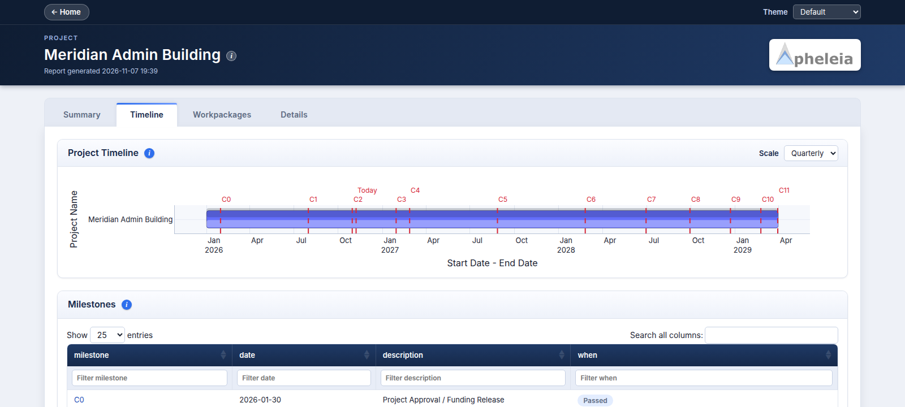
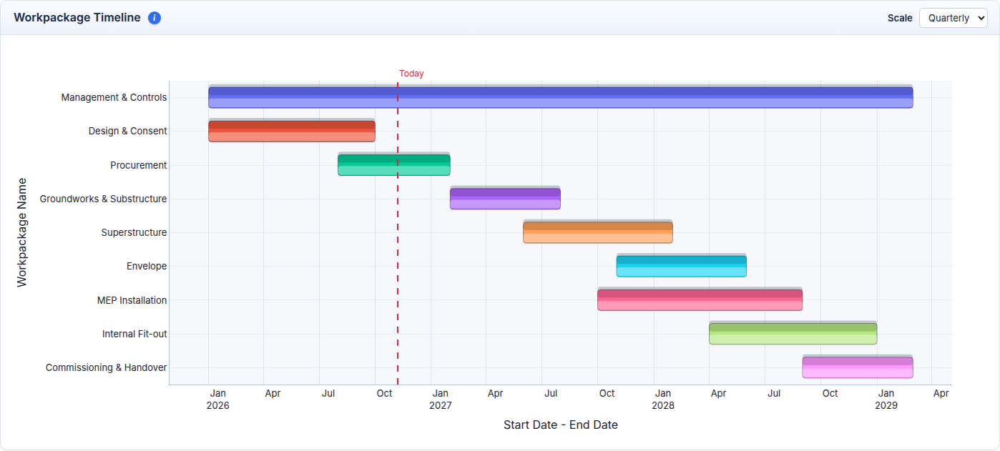
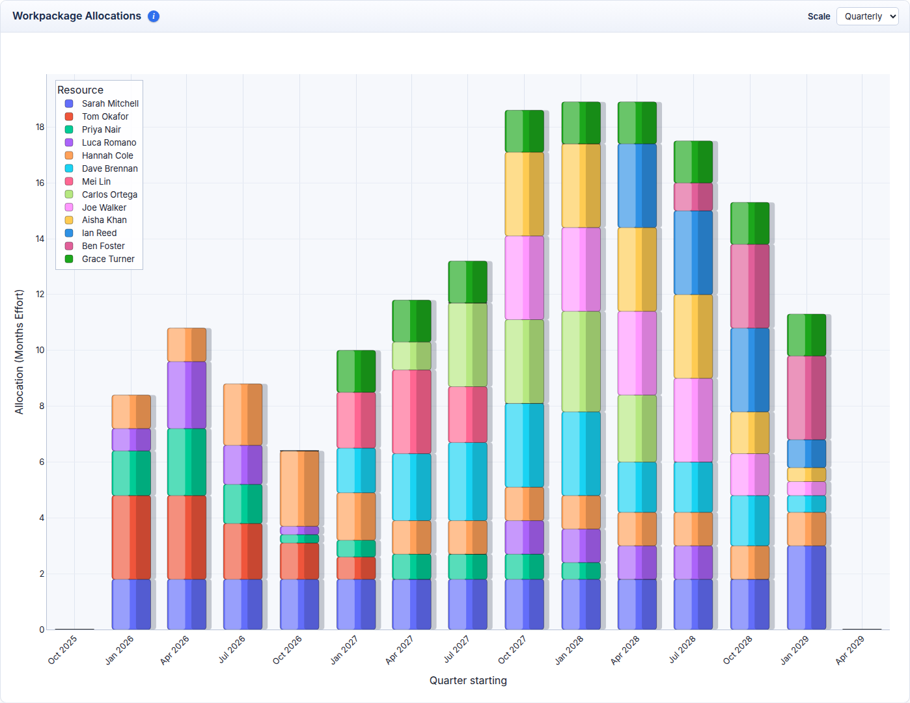
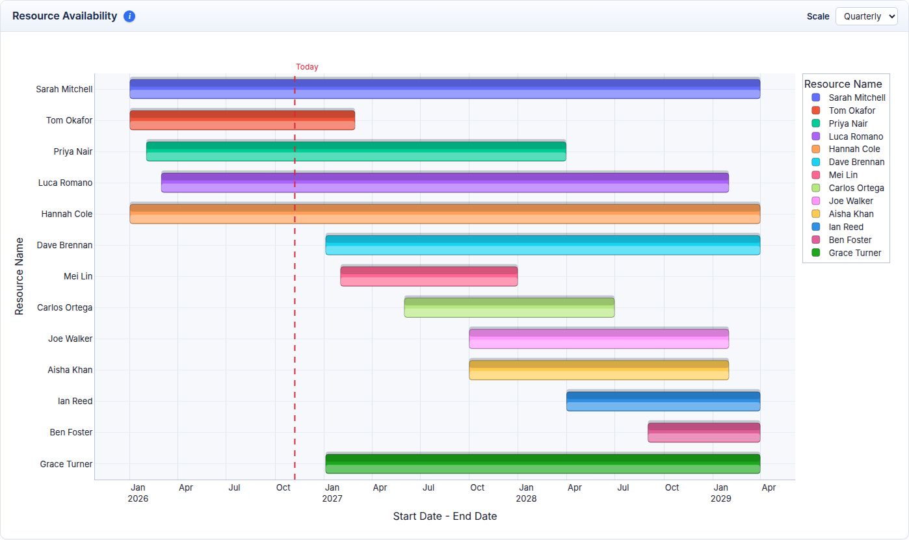
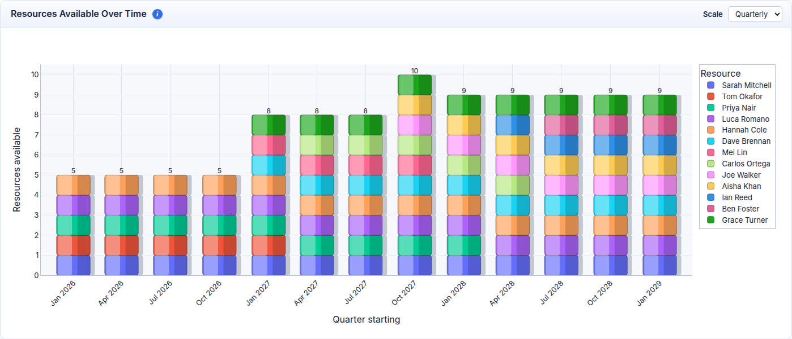
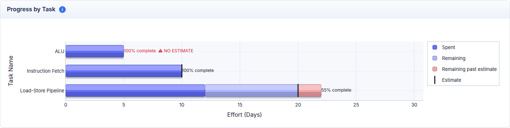
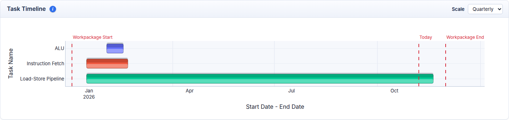
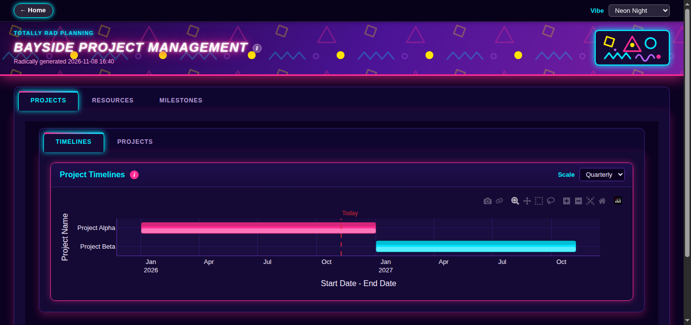
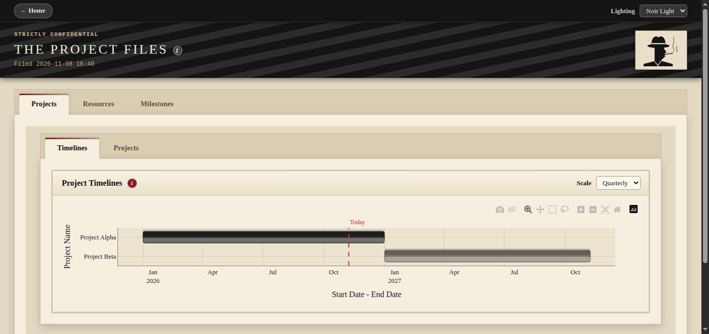

# Apheleia Project Management

[](https://github.com/projectapheleia/apheleia-project-management/blob/main/LICENSE)
[](https://www.python.org/)


Apheleia Project Management is a lightweight project planning and tracking tool developed in [Python](https://www.python.org/).

Projects, milestones, resources, workpackages and tasks are described in plain [YAML](https://yaml.org/) files. \
A single command reads those files and generates a static, interactive HTML report containing timelines, \
resource allocations and task progress.

Because the plan is just text, it can live in the same repository as the work it describes - reviewed, \
diffed and merged like any other source file.



---

## 📊 Features

- Project timelines, with milestones and today's date marked
- Task status by milestone, and tasks that have grown past their original estimate
- Task effort in man-days, weeks, months or years, and tasks shared by several people
- Workpackage timelines and the effort allocated to each
- Resource availability, and how each resource is allocated across projects and workpackages
- Task timelines, progress and forecast completion dates based on effort spent and remaining
- Interactive [plotly](https://plotly.com/python/) charts at monthly, quarterly or yearly scale
- Click any name in a table or bar in a chart to navigate to its page
- Static HTML output - no server, no database

| | |
| --- | --- |
|  |  |
|  |  |
|  |  |

### Input files

All inputs are YAML files with a `type` and a list of `data`. The input directory is searched recursively and \
all definitions of the same type are combined, so the plan can be one file per type or split by owner.

| Type | Defines |
| --- | --- |
| `milestones_definitions` | Named checkpoints shared by all projects |
| `resources_definitions` | People and when they are available |
| `projects_definitions` | Projects, their dates and milestone dates |
| `workpackages_definitions` | Areas of work and the resources allocated to them |
| `tasks_definitions` | Individual tasks and their status history (effort spent and remaining) |

```yaml
type: "milestones_definitions"
data:
  - milestone: "M0"
    description: "Project Definition"
```

See [the documentation](https://github.com/projectapheleia/apheleia-project-management/blob/main/doc/source/inputs/inputs.rst) for the full field reference.

### Customising the report

The title, the logo in the banner, and the colours, fonts and chart colours of the themes are all defined in YAML, \
in `format_definitions` and `themes_definitions` files in the input directory. Add your own themes to the \
built-in ones, or replace them.

```yaml
type: "format_definitions"
data:
  title: "Acme Project Management"
  default_theme: "sepia"
  logo:
    file: "acme.png"
```

| | |
| --- | --- |
|  |  |

The [format examples](https://github.com/projectapheleia/apheleia-project-management/tree/main/examples/format) show a neon, geometric eighties format with added themes, and a film noir format with the built-in themes replaced by `Noir Light` and `Noir Dark`. \
See [the documentation](https://github.com/projectapheleia/apheleia-project-management/blob/main/doc/source/report/format.rst) for every setting.

### Generating a report

```sh
apheleia_project_report --input <input directory> --html <output directory>
<browser> <output directory>/index.html
```

`--input` defaults to `.` and `--html` to `./html`.

>**NOTE**:
>The charting and table libraries are loaded from their public CDNs, so an internet connection is required to view the report.

---

## 📦 Installation

### Install from Source
```sh
git clone https://github.com/projectapheleia/apheleia-project-management.git
cd apheleia-project-management

# Standard build
pip install .

# Development build
pip install .[dev]
```

Alternatively if you want to create a [virtual environment](https://docs.python.org/3/library/venv.html) rather than install globally a script is provided. This will install, with edit privileges to local virtual environment.

This script assumes you have [Graphviz](https://graphviz.org/download/) installed, so the documentation will build out of the box.

```sh
git clone https://github.com/projectapheleia/apheleia-project-management.git
cd apheleia-project-management
source setup.sh
```

## 📖 Documentation

In order to build the documentation you must have installed the development build.

### Build from Source
```sh
cd doc
make html
<browser> build/html/index.html
```

## 🏃 Examples

To build the report for all examples:

```sh
cd examples

# To build
make report

# To clean
make clean
```

To build an individual example:

```sh
cd examples/THE EXAMPLE YOU WANT

# To build
make report

# To clean
make clean
```

| Example | Description |
| --- | --- |
| [simple](https://github.com/projectapheleia/apheleia-project-management/tree/main/examples/simple) | Minimal semiconductor project, one file per type. The best starting point for a new plan |
| [milestones](https://github.com/projectapheleia/apheleia-project-management/tree/main/examples/milestones) | Single date milestones, milestone windows and relative milestone dates, and the mistakes that are caught |
| [workpackages](https://github.com/projectapheleia/apheleia-project-management/tree/main/examples/workpackages) | Workpackage estimates (none, generous, low and exact), and the mistakes that are caught |
| [tasks](https://github.com/projectapheleia/apheleia-project-management/tree/main/examples/tasks) | Good and bad task estimates, tasks shared by several people, effort in md, mw, mm and my, and the mistakes that are caught |
| [resources](https://github.com/projectapheleia/apheleia-project-management/tree/main/examples/resources) | Availability periods: leave, part time working, people joining and leaving, and the mistakes that are caught |
| [format](https://github.com/projectapheleia/apheleia-project-management/tree/main/examples/format) | Two reports with their own title, logo and themes (`eighties` and `noir`), and the mistakes that are caught |
| [construction_single](https://github.com/projectapheleia/apheleia-project-management/tree/main/examples/construction_single) | Multi-year construction project, one file per type |
| [construction_multi](https://github.com/projectapheleia/apheleia-project-management/tree/main/examples/construction_multi) | The same construction project, split into shared definitions and a tasks file per resource |

---


## 🧹 Code Style & Linting

This project uses [**Ruff**](https://docs.astral.sh/ruff/) for linting and formatting.

Check code for issues:

```sh
ruff check .
```

Automatically fix common issues:

```sh
ruff check . --fix
```

## 📧 Contact

- Email: avl@projectapheleia.net
- GitHub: [projectapheleia](https://github.com/projectapheleia)
